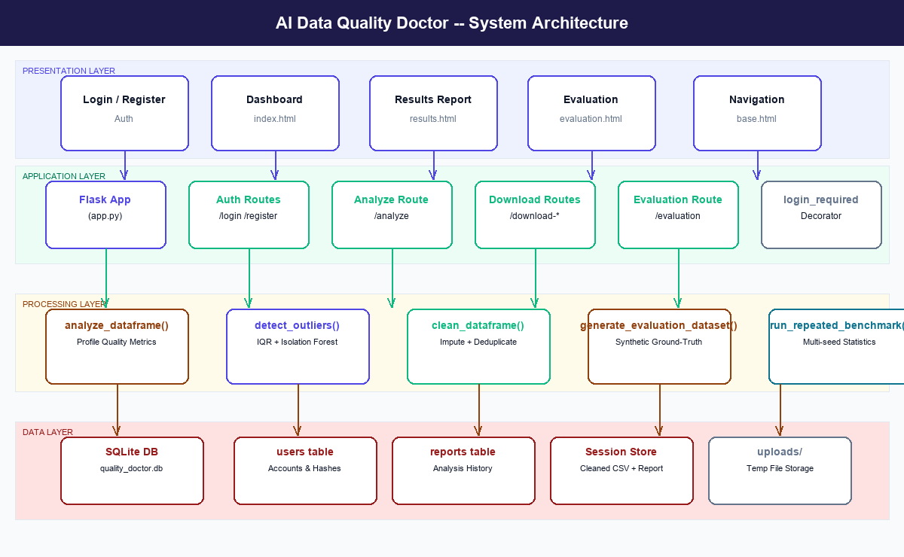
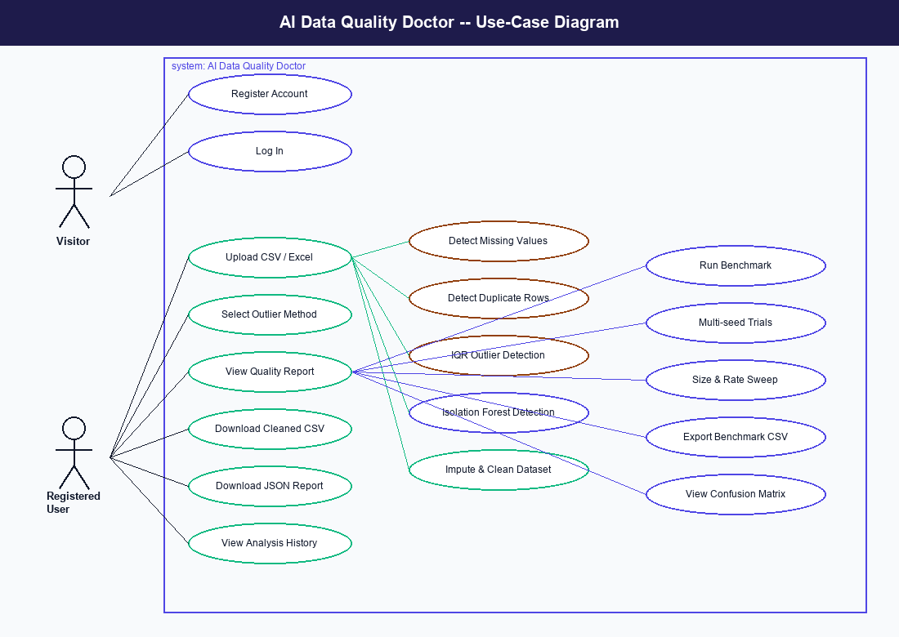
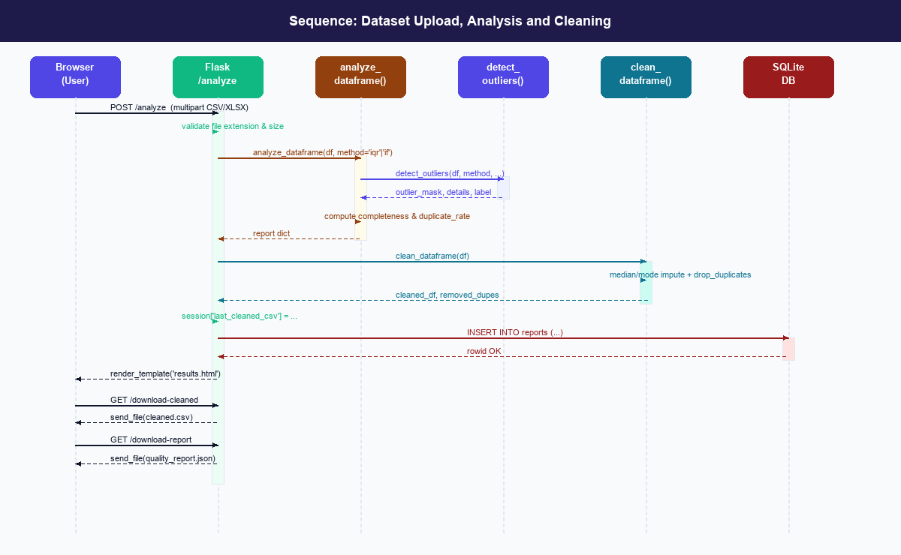
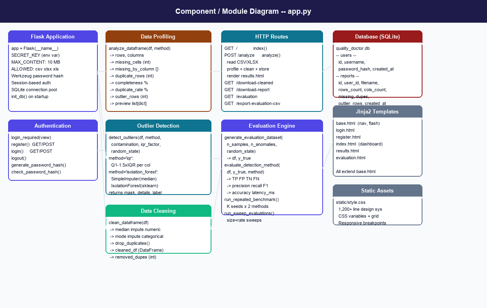
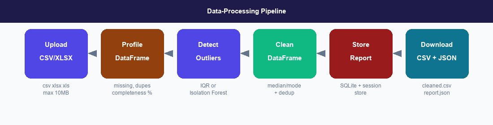
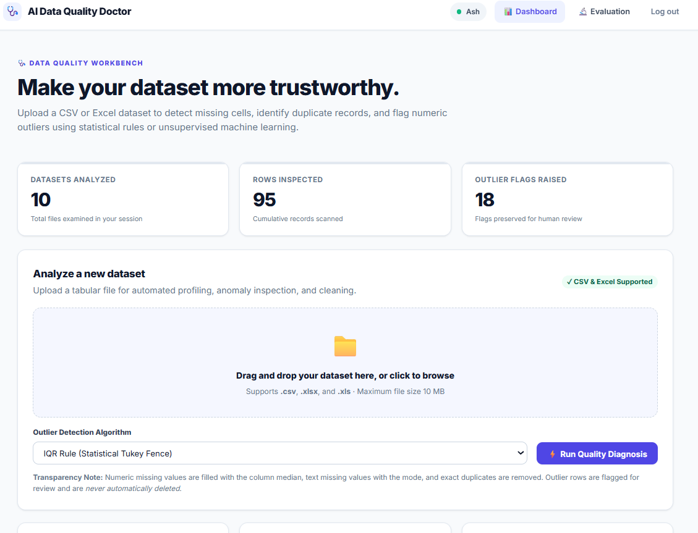
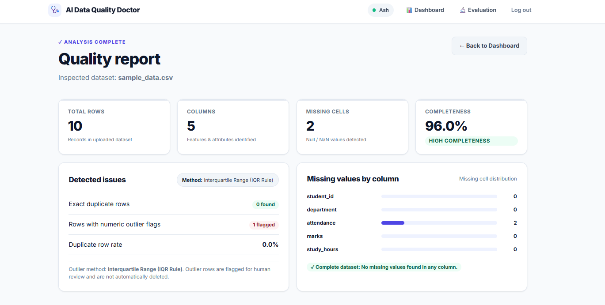

# AI Data Quality Doctor – AI-Powered Dataset Cleaning and Quality Analysis System

## Title of the Project

**AI Data Quality Doctor – AI-Powered Dataset Cleaning and Quality Analysis System**

---

## Small Description

AI Data Quality Doctor is an AI-powered web application designed to analyze, clean, and improve the quality of datasets. It identifies missing values, duplicate records, and outliers using statistical methods and machine learning algorithms, helping users prepare reliable data for analysis and machine learning applications.

---

## About

**AI Data Quality Doctor** is an intelligent dataset-quality analysis platform developed using Flask, Python, pandas, and scikit-learn.

Poor data quality can affect the accuracy of data analysis and machine learning models. Missing values, duplicate records, and unusual data points can lead to incorrect results. This project provides an integrated platform to identify and address these common data-quality problems.

The system allows users to upload CSV and Excel datasets, analyze their quality, clean the data, and download the processed results.

The application provides:

- Automated dataset profiling and quality analysis
- Missing-value imputation and duplicate removal
- Statistical and machine learning-based outlier detection
- Interactive dashboard and analysis history
- Downloadable cleaned datasets and quality reports
- Evaluation and comparison of outlier-detection methods

All these features are combined into one user-friendly web application.

---

## Features

- User registration, login, and authentication
- CSV and Excel dataset upload
- Automated data-quality analysis
- Missing-value detection and imputation
- Duplicate-row detection and removal
- Outlier detection using the IQR statistical method
- Outlier detection using Isolation Forest
- Interactive dashboard with dataset statistics
- Dataset preview and cleaning summaries
- Downloadable cleaned CSV files
- Downloadable data-quality reports in JSON format
- User-specific analysis history
- Machine learning evaluation dashboard
- Performance comparison using precision, recall, F1-score, accuracy, and execution time
- Repeated experiments using synthetic datasets

---

## Requirements

### Libraries Required

Install the project dependencies using:

```bash
pip install -r requirements.txt
```

The main libraries used in the project include:

- Flask
- pandas
- NumPy
- scikit-learn
- Werkzeug

### Operating System

- Windows 10/11
- Ubuntu Linux
- Other compatible operating systems with Python support

### Programming Language

- Python 3.10 or later, as specified by the project configuration

### Backend Framework

- Flask

### Data Processing and Machine Learning Libraries

- pandas
- NumPy
- scikit-learn

### Database

- SQLite

### Frontend Technologies

- HTML
- CSS
- JavaScript
- Jinja2 templates

### Development Tools

- Visual Studio Code or Antigravity
- Git for version control
- A modern web browser

---

## Installation and Setup

### Step 1: Navigate to the Project Directory

```bash
cd ai_data_quality_doctor
```

### Step 2: Create a Virtual Environment

```bash
python -m venv .venv
```

### Step 3: Activate the Virtual Environment

**Windows PowerShell:**

```powershell
.venv\Scripts\Activate.ps1
```

**Ubuntu/Linux:**

```bash
source .venv/bin/activate
```

### Step 4: Install Dependencies

```bash
pip install -r requirements.txt
```

### Step 5: Run the Application

```bash
python app.py
```

### Step 6: Open the Website

Open the following address in your browser:

`http://127.0.0.1:5000/`

Register or log in, upload a dataset, and start analyzing its data quality.

---

## System Architecture

### System Architecture Diagram



The application uses a web-based architecture in which users interact with the frontend, the Flask backend processes uploaded datasets, machine learning algorithms identify outliers, and SQLite stores user accounts and analysis history.

---

## UML Diagrams

### Use-Case Diagram



Illustrates how visitors and registered users interact with the application, including registration, login, dataset upload, analysis, cleaning, and report downloads.

### Sequence Diagram



Shows the sequence of interactions between the user, web application, data-processing functions, and database during dataset analysis and cleaning.

### Component Diagram



Illustrates the main application components and their relationships, including authentication, data analysis, outlier detection, cleaning, and evaluation.

### Data-Processing Pipeline



Shows the major stages of the application, from dataset upload and profiling to outlier detection, data cleaning, and downloading the results.

---

## Output

### Output 1 – Main Dashboard



Displays the dataset upload interface, quality-analysis options, summary statistics, and recent analysis history.

### Output 2 – Dataset Quality Analysis



Displays dataset statistics, missing-value information, duplicate records, outlier counts, and overall data completeness.


---

## Model Evaluation and Performance

The project includes an evaluation dashboard that compares two outlier-detection methods: the Interquartile Range (IQR) rule and Isolation Forest.

A synthetic dataset with known anomaly labels is generated to evaluate the detection methods under controlled conditions.

The evaluation uses the following metrics:

- **Precision:** Measures the proportion of detected anomalies that are actual anomalies.
- **Recall:** Measures the proportion of actual anomalies correctly detected.
- **F1-score:** Combines precision and recall into a single metric.
- **Accuracy:** Measures the proportion of correctly classified rows.
- **Execution Time:** Measures the time required for outlier detection.

The system also supports repeated experiments and comparisons across different dataset sizes and anomaly proportions, where implemented.

The results help illustrate the strengths and limitations of statistical and machine learning-based outlier detection. Performance on synthetic datasets may differ from performance on real-world datasets.

---

## Results and Impact

AI Data Quality Doctor provides an integrated solution for identifying and addressing common data-quality problems.

The application helps users understand their datasets, identify missing values and duplicates, detect unusual records, and generate cleaned datasets for further analysis.

The evaluation dashboard also provides a way to compare statistical and machine learning-based anomaly-detection techniques using measurable performance metrics.

This project demonstrates the practical application of artificial intelligence, machine learning, statistical analysis, and full-stack web development in improving data quality.

It can be useful for students, data analysts, researchers, and anyone preparing tabular datasets for data science and machine learning workflows.

---

## Future Enhancements

- Add interactive visualizations for data distributions and outliers.
- Support additional anomaly-detection algorithms.
- Evaluate detection methods on labelled real-world datasets.
- Develop a REST API for integration with external applications.
- Add more advanced data-quality reports.
- Deploy the application to a cloud platform.
- Improve security and support larger datasets.

---

## References

1. Flask Documentation. Pallets Projects.  
   https://flask.palletsprojects.com/

2. pandas Documentation.  
   https://pandas.pydata.org/docs/

3. NumPy Documentation.  
   https://numpy.org/doc/

4. scikit-learn Documentation.  
   https://scikit-learn.org/stable/

5. Liu, F. T., Ting, K. M., and Zhou, Z.-H. (2008). *Isolation Forest*. Proceedings of the Eighth IEEE International Conference on Data Mining.  
   https://doi.org/10.1109/ICDM.2008.17

6. Tukey, J. W. (1977). *Exploratory Data Analysis*. Addison-Wesley.

7. Chandola, V., Banerjee, A., and Kumar, V. (2009). Anomaly Detection: A Survey. *ACM Computing Surveys*, 41(3).  
   https://doi.org/10.1145/1541880.1541882

---

**AI Data Quality Doctor – Final-Year Engineering Project**

*Built with Python, Flask, pandas, and scikit-learn.*

*Note: This project is an educational prototype. Outlier detections should be reviewed before removing or modifying records, and sensitive datasets should not be uploaded without appropriate safeguards.*
